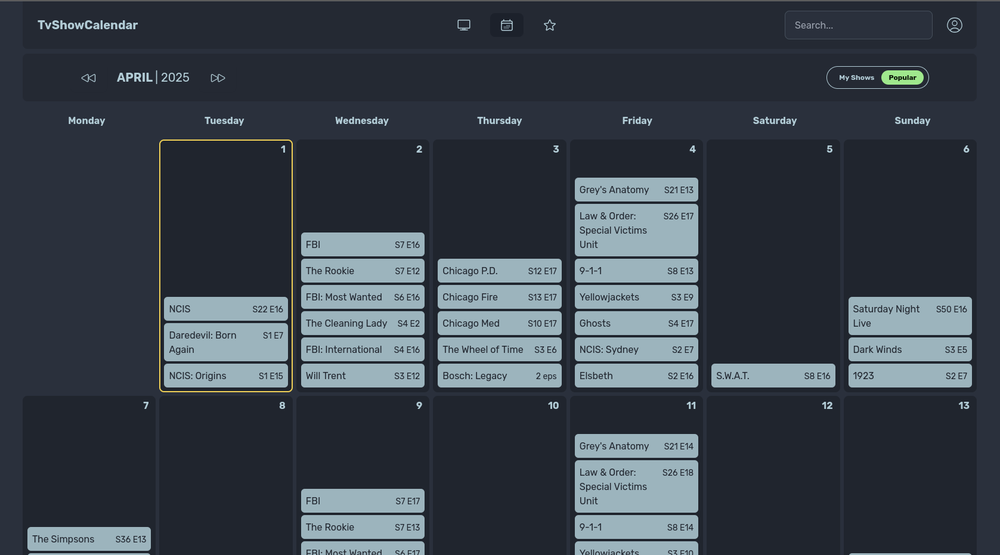
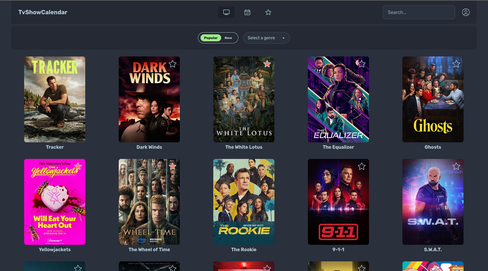

# Tv Show Calendar

A web app for tracking and discovering TV shows. Users can search for shows, add them to their list and view upcoming shows on a calendar.

## Screenshots

#### Calendar

#### Discover page

## Technologies used

- PHP (Slim framework, Doctrine ORM)
- Twig
- Typescript
- Postgres
- Nginx
- Docker

## License

Licensed under the [GNU Affero General Public License v3.0 or later](LICENSE)
(AGPL-3.0-or-later). If you run a modified version of this app as a network
service, the AGPL requires you to offer its complete source code to your users.

Versions published before 21 November 2026 were released under the MIT License;
see [NOTICE](NOTICE) for details.
